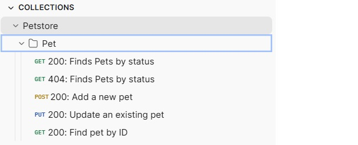
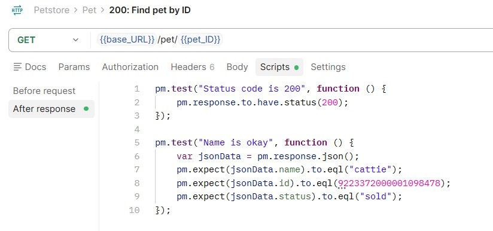
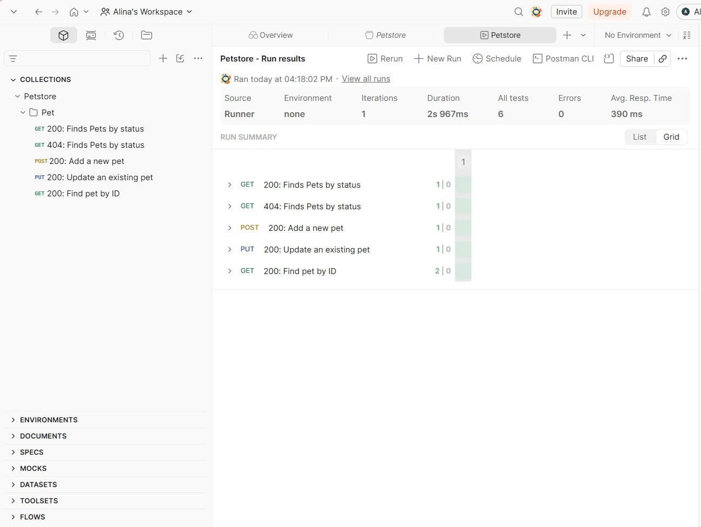
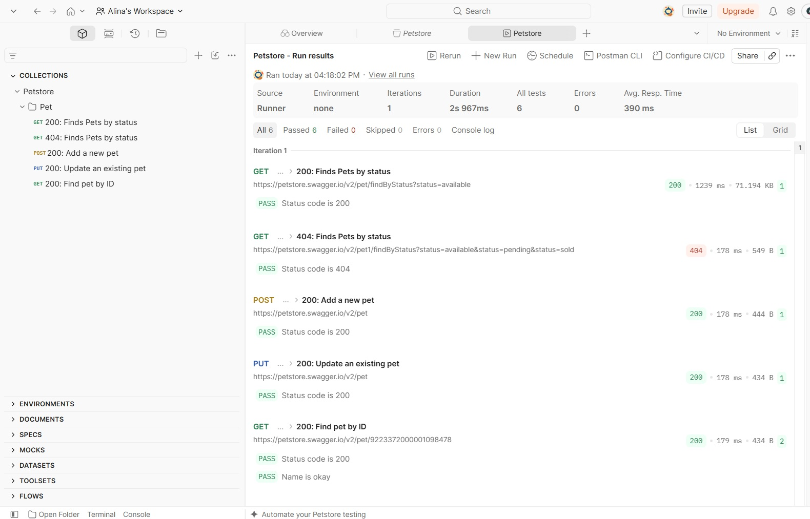

# Тестирование Petstore API

Учебный проект по тестированию REST API с использованием Postman и публичного API Swagger Petstore.

## О проекте

Цель проекта — получить практический опыт тестирования API, научиться работать с HTTP-запросами и ответами сервера, а также писать автоматизированные проверки на JavaScript.

## Инструменты и технологии

- Postman
- REST API
- JavaScript
- JSON
- Swagger Petstore API

## Объём тестирования

В коллекцию Postman включены следующие запросы:

| Запрос | Метод | Ожидаемый статус |
|---|---|---|
| Поиск питомцев по статусу | GET | 200 |
| Поиск питомцев по статусу (несуществующий endpoint) | GET | 404 |
| Добавление нового питомца | POST | 200 |
| Обновление информации о питомце | PUT | 200 |
| Поиск питомца по ID | GET | 200 |

## Выполненные проверки

- Проверка HTTP-статусов ответов сервера
- Проверка структуры и содержимого JSON-ответов
- Проверка имени и ID питомца
- Проверка соответствия полученных данных ожидаемым значениям
- Проверка обработки запроса к несуществующему endpoint

## Результаты тестирования

Все настроенные автоматизированные проверки завершились успешно. Для запроса к несуществующему endpoint был скорректирован ожидаемый статус ответа с учётом фактического поведения API.

## Файлы проекта

- `Petstore.postman_collection.json` — коллекция Postman с API-запросами и тестовыми скриптами.
- `screenshots/` — скриншоты коллекции, JavaScript-проверок и результатов тестирования.

## Скриншоты

### Коллекция Postman

### JavaScript-проверки

### Результаты тестирования

## Тип проекта

Учебный проект, выполненный в рамках самостоятельного изучения тестирования программного обеспечения.

---

# Petstore API Testing

Educational project focused on REST API testing using Postman and the public Swagger Petstore API.

## Project Overview

The goal of this project was to gain practical experience in API testing, working with HTTP requests and responses, and writing automated test assertions in JavaScript.

## Tools & Technologies

- Postman
- REST API
- JavaScript
- JSON
- Swagger Petstore API

## Test Scope

The Postman collection includes the following requests:

| Request | Method | Expected Status |
|---|---|---|
| Find pets by status | GET | 200 |
| Find pets by status (non-existent endpoint) | GET | 404 |
| Add a new pet | POST | 200 |
| Update an existing pet | PUT | 200 |
| Find pet by ID | GET | 200 |

## Tests Performed

- Verified HTTP response status codes
- Checked JSON response structure and content
- Validated pet name and ID
- Compared actual response data with expected values
- Tested a request to a non-existent endpoint

## Test Results

All configured automated test assertions passed successfully. The expected status code for the non-existent endpoint was adjusted to match the actual API response.

## Project Files

- `Petstore.postman_collection.json` — Postman collection containing API requests and test scripts.
- `screenshots/` — screenshots of the collection, JavaScript test scripts, and test execution results.

## Screenshots

### Postman Collection

### JavaScript Test Scripts

### Test Results

## Project Type

Educational project completed as part of independent software testing studies.
